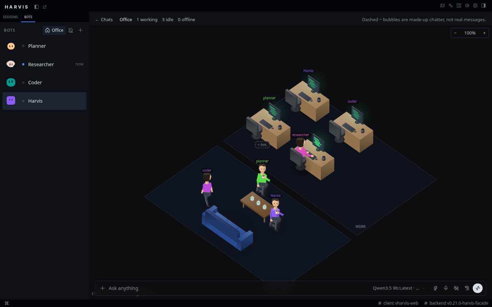
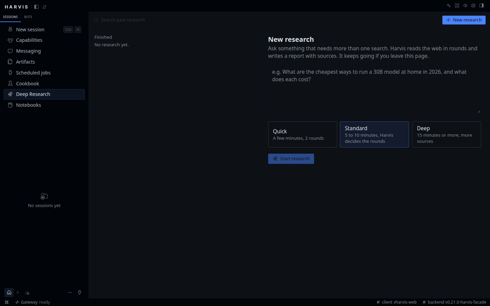
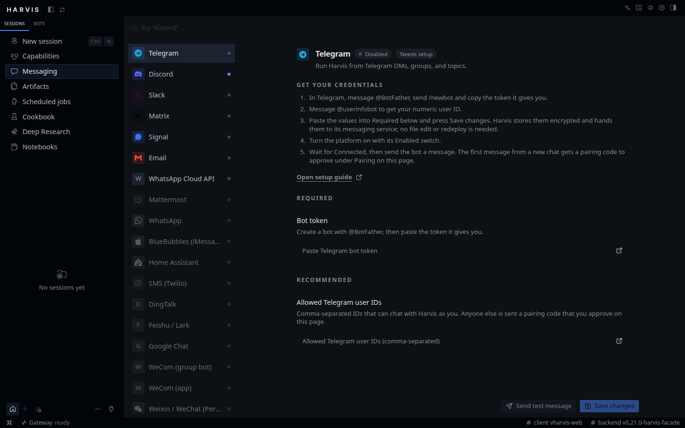

# Harvis

An open-source, self-hosted AI workspace: an alternative to Open WebUI and Claude Desktop that you
run on your own machine or host for your own network. You bring the model server (Ollama, LM
Studio, llama.cpp, vLLM or anything OpenAI-compatible); Harvis brings the chat, the agent, the
notebooks, the voice and the accounts.

**Version 0.2.0** · MIT license · Ubuntu, Windows 11 and macOS through Docker



## What it does

- **Chat** with any model you run, with the model's thinking shown as it works.
- **Agent runs** on Harvis's own runner, with tools, approvals before risky steps and a sandbox
  per chat. The agent can drive a real browser and preview what it builds. For a full desktop on
  the agent's screen, add `./install.sh --bot-desktop` (about 270 MB more, off by default).
- **Documents**: ask for slides, a Word document, a PDF or a spreadsheet, or several in one
  request, and the files come back in the chat.
- **Notebooks**: add your own sources, ask across them, get answers with citations.
- **Voice** on the CPU: Whisper speech-to-text and Kokoro text-to-speech on ONNX, no PyTorch.
- **MCP servers**, **bots** and a **messaging gateway** for reaching Harvis from other apps.
- **Per-user mods**: each account can change its own look and rules. A mod only turns on after its
  owner approves it, and it cannot touch another account.
- **The office**: the Bots tab draws your bots in a small office. A bot that is working sits at
  its desk, an idle one is in the lounge, and a click on either opens its chat. A pixel town
  (the island) sits behind the new-chat page.
- **Model hosting on your LAN**: a k3s mode, and inference nodes so another GPU box can register
  as a model source. See [Kubernetes hosting](#kubernetes-hosting).
- **No GPU needed for Harvis itself.** The GPU work happens in your model server.

| Deep research | Messaging |
|---|---|
|  |  |

## Requirements

| | |
|---|---|
| OS | Ubuntu 22.04 or 24.04 · Windows 11 with Docker Desktop (WSL 2) · macOS with Docker Desktop |
| Docker | Docker Engine with the `docker compose` plugin (v2) |
| Memory | 8 GB or more. The installer warns below that. |
| Disk | Plan for 15 GB free. The default images measure 9.1 GB, the voice models add about 1.1 GB on first run, and a build keeps some cache. |
| Models | A model server you already run. Without one Harvis still starts and you attach one later in Settings. |

Kubernetes (k3s) mode is Linux only.

## Install

```bash
git clone https://github.com/brandoz2255/Harvis.git
cd Harvis
```

**Ubuntu**

```bash
./install.sh --check-only   # preflight only, changes nothing
./install.sh                # detect a model server, write .env, build and start
./install.sh --yes          # the same, without questions
```

**Windows 11** (PowerShell, in the repository folder)

```powershell
.\install.ps1 -CheckOnly
.\install.ps1 -VerifyGpu    # optional, skip on a CPU-only machine
.\install.ps1 -Yes
```

**macOS:** Docker cannot reach the Mac GPU, so run Ollama natively and then `./install.sh`.

The installer generates every secret, writes `.env` with owner-only permissions, creates the
Docker network and starts the stack. There is nothing to choose and no GPU question. When it
finishes, open **`http://localhost:9000/harvis/`**. The first account made on a fresh install is
the admin.

### Model server

The installer probes this machine and uses the first server it finds:

| Port | Server |
|---|---|
| 11434 | Ollama |
| 1234 | LM Studio |
| 8080 | llama.cpp |
| 8000 | vLLM |

To point somewhere else:

```bash
./install.sh --llm-url http://host.docker.internal:11434
```

Inside a container `localhost` means the container, so use `host.docker.internal` or a LAN
address for a server on your own machine. The Windows installer does this mapping for you.

### Who can reach it

A new install answers on this computer only. Change that with `--expose`:

| Mode | Reach | Notes |
|---|---|---|
| `local` | this computer | the default |
| `lan` | your network | the first sign-up becomes admin, then sign-up closes until you open it in Settings |
| `tunnel`, `lan+tunnel` | the internet | **experimental**: a Cloudflare Tunnel behind Cloudflare Access |

```bash
./install.sh --expose lan
./install.sh --k8s          # run on k3s and host models for your LAN (Linux)
./install.sh --k8s-off      # back to plain Docker, all data kept
./install.sh --stop         # stop the stack; --start brings it back
./install.sh --admin-code   # a new 6-digit first-admin code for a shared server
```

Browsers only hand out the microphone over HTTPS or at `localhost`. For voice from another
machine on your network, run `./scripts/enable-https.sh`.

## Kubernetes hosting

Docker is the default. On Linux, one flag moves the same install onto k3s so one machine can
serve Harvis and its models to your whole network:

```bash
./install.sh --k8s
```

It needs `sudo` and Docker. It installs k3s with the official k3s installer, starts Harvis in a
`harvis` namespace and prints the address, `http://<this machine's address>:9000`. Reach defaults
to `lan` in this mode.

- **Same data, either way.** Both modes read the same Docker volumes, so switching moves nothing
  and loses nothing. The Kubernetes objects are generated from `docker-compose.yaml` on every
  start, so the two modes cannot drift apart.
- **Models run in the cluster.** Ollama starts as a pod, on the NVIDIA GPU when the machine has
  one and on the CPU when it does not. Pass `--llm-url` to use your own model server instead.
- **Models are shared on your network** on port 11434 (11435 when that is taken), for chat and
  model listing only. Set `HARVIS_LAN_MODELS_PORT=0` in `.env` to keep them private. Only do this
  on a network you trust; it is not meant for the open internet.
- **Build Space is off** in this mode, because it would hand the backend the Docker socket. Set
  `HARVIS_K8S_BUILD_SPACE=1` in `.env` only if you accept that a taken-over backend controls the
  machine.

Add a model:

```bash
sudo k3s kubectl -n harvis exec deploy/ollama -- ollama pull gemma4:e2b
```

Add more machines. Run the first command on the server; it prints the second one, with the
server address and a token filled in, for you to run on each machine that should join:

```bash
./install.sh --k8s-join-command
./install.sh --k8s-join https://<server address>:6443 <token>
```

Treat that token like a password: anyone holding it can add machines to the cluster.

| Command | What it does |
|---|---|
| `./install.sh --k8s-status` | nodes, pods and addresses |
| `./install.sh --stop` / `--start` | stop Harvis and bring it back |
| `./install.sh --k8s-off` | back to plain Docker; nothing is deleted |
| `./install.sh --k8s-uninstall` | the same, then remove k3s from the machine |

## What gets installed

A plain install starts 13 services and nothing else:

| Service | Job |
|---|---|
| `nginx` | the front door on port 9000; serves the UI and proxies `/api` |
| `backend` | FastAPI: chat, agent runner, auth, routing |
| `pgsql` | Postgres 15 with pgvector |
| `hermes-ui-builder` | builds the desktop UI once and hands it to nginx |
| `voice-onnx` | Whisper and Kokoro speech |
| `sandbox`, `repo-sandbox-image`, `box-egress` | where agent code runs, and what it may reach |
| `browser-runner`, `preview-runner` | the agent's browser and live previews |
| `harvis-mcp` | MCP server |
| `harvis-messaging-gateway` | messaging and bots |
| `llmfit` | checks which models fit your hardware |
| `artifact-init` | one-shot volume setup |

Every published port binds to `127.0.0.1` unless you choose `lan`.

More is opt-in through compose profiles, so the default stays small:

| Profile | Adds | Size |
|---|---|---:|
| `engines` | Hermes Agent, Claude Code and Codex as coding engines | 9.8 GB |
| `notebooks` | the notebook UI and document worker | 1.5 GB |
| `cad` | the CAD engine | 1.7 GB |
| `advanced-voice` | GPU voice models | 37.6 GB |
| `tunnel` | the Cloudflare tunnel connector (experimental) | small |

Per-profile numbers and how they are measured: [`docs/deploy/STORAGE-BUDGET.md`](docs/deploy/STORAGE-BUDGET.md).
A check on every change fails the build if the default images grow past 10 GB.

## Stack

- **Backend:** Python 3.12, FastAPI, Postgres 15 with pgvector. Features live as plugins under
  `python_back_end/plugins/`.
- **Frontend:** the Hermes desktop UI (React, Vite, TypeScript, Tailwind), built to a static
  bundle and served by nginx.
- **Speech:** ONNX Runtime with Whisper and Kokoro.
- **Deploy:** Docker Compose, or k3s through `scripts/k8s/`.
- **CI:** GitHub Actions for backend tests, UI tests, the installers, the image size guard and
  security scans (CodeQL, Semgrep, Trivy, Gitleaks).

## Repository layout

| Path | What is there |
|---|---|
| `install.sh`, `install.ps1` | the installers |
| `docker-compose.yaml` | every service, network and volume |
| `python_back_end/` | the backend and its tests |
| `front_end/hermes-desktop-ui/` | the live UI; Harvis code is under `src/plugins/harvis/` and `src/mods/` |
| `services/voice-onnx/` | the speech sidecar |
| `browser_runner/`, `repo-sandbox-engine/`, `box-egress/` | agent browser, sandbox and egress control |
| `scripts/k8s/` | the k3s mode |
| `docs/` | deploy notes, designs and handoffs |

Earlier versions of Harvis (a Next.js frontend, Open WebUI, OpenClaw, n8n) are not in this tree.
Their code and guides are in the repository history.

## Development

```bash
docker compose up --build -d      # build and run the whole stack
docker compose logs -f backend    # follow one service
docker restart harvis-backend     # the backend is bind-mounted; restart to pick up Python changes
docker compose down               # stop everything
```

Publish a UI change on a running install:

```bash
HARVIS_HERMES_UI_NODE_HEAP_MB=6144 docker compose build hermes-ui-builder
docker compose up hermes-ui-builder
docker restart nginx-proxy
```

For a fast UI loop: `cd front_end/hermes-desktop-ui && npm install`, then
`npx vitest run --project ui <paths>` and `npx tsc --noEmit -p .`.

Backend tests, offline, from the repository root:

```bash
docker run --rm --network none -e HARVIS_ALLOW_EPHEMERAL_JWT_SECRET=1 \
  -v "$PWD:/repo:ro" -w /repo/python_back_end --entrypoint python \
  harvis-backend:latest -m pytest -q -p no:cacheprovider -o addopts="" tests
```

## Security

- The stack refuses to start without `JWT_SECRET` and `POSTGRES_PASSWORD`. The installers
  generate both; nothing ships with a default password.
- Ports are loopback-only by default. Reaching Harvis from the network is a choice you make
  with `--expose`.
- On a shared server the first admin needs a 6-digit code shown on the host.
- Accounts are isolated from each other, and agent code runs in a sandbox with controlled egress.
- The tunnel mode is experimental. Do not put Harvis on the public internet without it and
  without Cloudflare Access in front.

Report a vulnerability through [`SECURITY.md`](SECURITY.md).

## License and credits

MIT, see [`LICENSE`](LICENSE). The project also asks that you use it responsibly:
[`docs/ETHICAL_USE.md`](docs/ETHICAL_USE.md) is a request, not a license condition.

Harvis adapts code from [NousResearch/hermes-agent](https://github.com/NousResearch/hermes-agent)
and other open-source projects, and the office view is drawn with the MIT-licensed Office 3D
renderer; [`NOTICE`](NOTICE) lists them.
